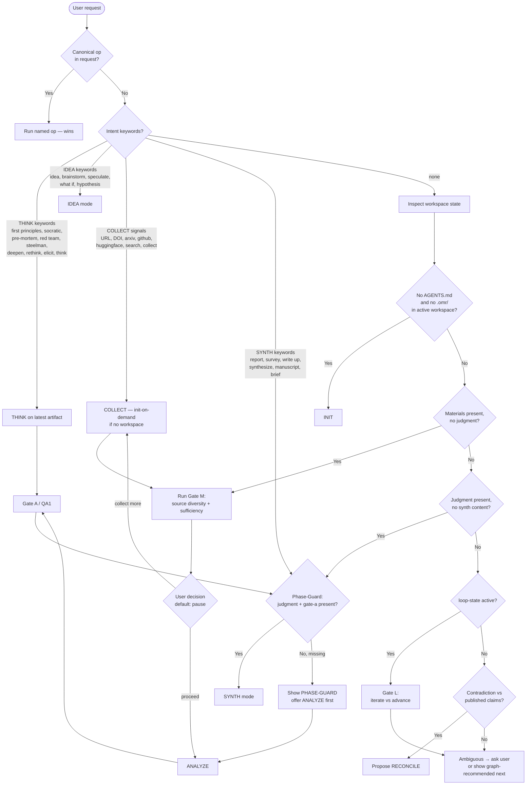

# Oh-My-Research

Intelligent orchestrator for **report-first deep research**. Auto-detects user intent and workspace state, then executes the right mode — initialize, collect materials, deep-analyze with evidence boundaries and thinking paradigms, synthesize a survey/report, or maintain state.

**North star:** high-quality deep research reports from collected materials and evidence — not prototypes, not coding validation.

## When to Use This Skill

- **Start** a research workspace on a topic
- **Collect** papers, URLs, repos, datasets
- **Analyze** materials into evidence maps and judgments
- **Deepen** analysis with first principles, Socratic, triangulation, etc. (THINK)
- **Write** a survey, report, manuscript, or brief
- **Reconcile** when new evidence contradicts prior claims
- **Run** the full Evidence-Deep workflow

**Keywords**: research, survey, literature review, evidence, collect papers, analyze, first principles, synthesize report, deep research, oh-my-research, omr

## Core Pipeline (Evidence-Deep)

```
COLLECT materials → [Gate M] → ANALYZE (deep evidence + THINK) → [Gate A] → [Gate P] → SYNTH (survey / report)
```

Optional: IDEA, DECIDE (stance), RECONCILE. Default pattern: **Evidence-Deep**. See `references/GRAPH.md` and `patterns/`.

## Workspace resolution (multi-topic)

`_omr/` is the **default OMR working root (a container)**, not necessarily the active workspace. The active workspace is the topic root that every op reads and writes.

1. If the user explicitly passes `--workspace <path>` or names a workspace, use it verbatim as the active workspace. Do **not** append a topic slug.
2. Otherwise resolve `<project-root>/_omr/` as the working root and **scan it before INIT**:
   - A topic workspace is any directory containing `AGENTS.md` **and** `.omr/tree-state.json`. The working root itself counts for legacy single-topic workspaces.
   - Match the new request against topic slug, `AGENTS.md` research question/title, and existing deliverable names. Exactly one match → resume that workspace. Several matches → ask the user. No match → INIT a new `<working-root>/<topic-slug>/`.
3. Set the active workspace to the resolved topic root. All state reads (`.omr/tree-state.json`, gates, report-state) and all mechanical scripts use this root. Script defaults (`<cwd>/_omr`) point at the container, so pass `--workspace <topic-root>` explicitly whenever the active workspace is a topic subdirectory.

```
<project-root>/_omr/                       # default working root (container)
├── AGENTS.md, .omr/...                    # legacy single-topic workspace (still supported)
├── yolo-vs-rfdetr/                        # topic workspace A
│   ├── AGENTS.md, .omr/...
│   └── deliverables/
└── veya-tracing/                          # topic workspace B
    ├── AGENTS.md, .omr/...
    └── deliverables/
```

Never re-INIT a matched topic root; resume its tree-state instead. Never write into a sibling topic while working on another topic.

## Auto-Detection Decision Tree

The agent runs **intention detection first**, then falls back to **workspace-state detection**. Canonical op names (`init`, `collect`, `analyze`, `think`, `synth`, `decide`, `idea`, `reconcile`, `workflow`, `qa`) **always win** over keyword routing.



In semi-automated mode, every gate decision node is a **real pause**: show the gate report, end the turn, and wait for the next user message. Quick-pass and Rapid skip the pause only after `gate_cli.py set` has stored an explicit user request or the Rapid pattern; the gate JSON must still be recorded.

**Always show a phase label** at the start of each action: `[INIT]`, `[COLLECT]`, `[ANALYZE]`, `[THINK]`, `[SYNTH]`, `[RECONCILE]`, `[FINISHED]` (plus `[DECIDE]` / `[IDEA]` when used).

## Phase-Guard: Cross-Stage Jump Protection

Before routing to a stage, resolve the active workspace first (see Workspace resolution), **run `gate_cli.py validate` for the target stage**, then **read `<active-workspace>/.omr/tree-state.json`** and check whether the target stage is `unlocked`, `ready`, or `completed`. If `locked`, verify the required **prerequisite artifacts** exist on disk before proceeding. A gate validation failure blocks the stage just like a missing artifact. This prevents silent stage-skipping (e.g. user says "write report" → SYNTH keyword detected → but no `judgment-*.md` exists).

| Target stage | Required prerequisite artifacts | Required gate JSON | If missing |
|---|---|---|---|
| ANALYZE | `materials/` with ≥1 source + `docs/index/` entry | `gate-m.json` + `gate_cli.py validate --stage analyze` exit 0 | Route to COLLECT first |
| THINK | `docs/plans/judgment-*.md` or `docs/plans/evidence-*.md` | (none) | Route to ANALYZE first |
| SYNTH | `docs/plans/judgment-*.md` | `gate-a.json` (pass) + `gate-p.json` + `gate_cli.py validate --stage synth` exit 0 | Route to ANALYZE → THINK → Gate A → Gate P first |
| DECIDE | `docs/plans/judgment-*.md` | (none) | Route to ANALYZE first |

**Blocking by default.** The agent must not proceed past a missing prerequisite without either (a) satisfying the prerequisites or (b) receiving an explicit user override (e.g. "I know, just write the report" or "skip guard"). A general instruction like "write the report" does **not** count as an override. When overridden, record `scenario_note: "prerequisite skipped by user override"` in the next gate JSON for auditability.

**Tree-state staleness:** after every op, update `.omr/tree-state.json` — move completed stages to `completed`, unlock dependents, write a brief `notes` summary. A stale tree-state signals an interrupted workflow; check and refresh it at the start of any new op.

## Operation Modes

| Mode | Op | One-line | Detail |
|------|----|----------|--------|
| INIT | `init "<topic>" [--workspace <path>]` | Bootstrap a topic workspace (only `AGENTS.md` + `.omr/*.json`; no empty folders). Scan the working root for an existing topic first | `references/INIT/init.md` |
| COLLECT | `collect <url\|query\|…>` | Default **papers+web+github+search** (parallel bucket agents) → materials + indexes + full-text Markdown | `references/COLLECT/collect.md` |
| ANALYZE | `analyze` | Brief, evidence-map, judgment; reads full-text Markdown; Gate M before, Gate A / QA1 after, Gate T after THINK | `references/ANALYZE/analyze.md` |
| THINK | `think [method]` | Methodology-driven elicitation on research artifacts (never code); stamps `hardened`/`refined`/`unchanged`/`killed` | `references/THINK/think.md`, `references/THINK/methods/` |
| SYNTH | `synth [--mode] [--format docx\|pdf\|md] [--language] [--resume] [--chapter] [--no-wiki] [--workspace <path>]` | Incremental long reports in preferred language; Gate P confirms prefs; never one-shot a deep report; exports land in `<active-workspace>/deliverables/` | `references/SYNTH/synth.md`, `references/SYNTH/long-report.md`, `references/LANGUAGE.md` |
| IDEA | `idea "…"` | Capture speculative notes (optional) | `references/IDEA/idea.md` |
| DECIDE | `decide` | Stance / claim framing with ≥3 alternatives; Gate B (optional) | `references/DECIDE/decide.md` |
| RECONCILE | `reconcile` | Contradiction blast-radius, archive, rollback | `references/RECONCILE/reconcile.md` |
| VERSION | — | Workspace artifact versioning: tag, history, diff, backup, list | `references/VERSION/version.md` |
| WORKFLOW | `workflow [--pattern P]` | Graph-driven multi-step Evidence-Deep (or other pattern) | `references/WORKFLOW/workflow-overview.md` |
| QA | `qa qa1\|qa2\|all\|state-check` | LLM QA checklists; `state-check` reconciles disk vs tree-state and runs `gate_cli.py validate` in the active workspace | `references/GATES.md` |

Every op acts on the resolved active workspace. When calling mechanical scripts directly, add `--workspace <active-workspace>`; the built-in default `<cwd>/_omr` is the container, not a topic root.

## Confirmation Gates

Default **semi-automated** (pause for confirm). Support "no confirmations" / quick-pass. Rapid pattern skips all gates (fully-automated).

| Gate | When |
|------|------|
| M | After COLLECT: source diversity & enough materials? Shows diversity report, asks user: collect more types or proceed? |
| L | Loop pattern: iterate vs advance |
| A / QA1 | After ANALYZE judgment, before unlock SYNTH |
| T | After THINK: collect more from surfaced gaps? |
| B | Only if DECIDE runs |
| P | Before SYNTH: language / format / mode / audience / register / citations |
| Lenses | Structure → Prose → Adversarial before Gate D |
| D / QA2 | Before publishing SYNTH |

**Post-Step Routing Menu** (after Gate M / IDEA / Gate A / THINK proceed / Gate T / Gate B): (1) Pause at each gate (default) · (2) Quick pass · (3) Continue recommended (next graph edge) · (4) Run THINK · (5) Switch pattern · (6) Stop.

## Gate confirmation enforcement (blocking)

Gate quality is LLM-evaluated; **confirmation is mechanically validated** by `scripts/gate_cli.py` (persisted mode, gate record shape, chain order — never research quality). `.omr/gate-mode.json` is authoritative; `patterns/*.json` `recommendations.agency` is advisory only.

- Default mode is `semi-automated`: show the gate report, then **end the turn**; on the next user message record the gate with `gate_cli.py record` (`pause: true`). **Never self-authorize a pause skip** — switching to quick-pass requires `gate_cli.py set` with the user's explicit verbatim request (or the Rapid pattern for fully-automated).
- Run `gate_cli.py validate --stage <analyze|synth|all>` before ANALYZE, SYNTH, and export; a non-zero exit blocks the stage with the same blocking rule as Phase-Guard.
- All gate JSONs are written through `gate_cli.py record`; hand-written JSONs missing `decision_source` / `pause` / `user_decision` / `confirmed_at` fail validation.

CLI syntax, accepted mode-change phrases, and the full command table: `references/GATES.md` § Confirmation enforcement.

## Default Paths

`<workspace>` below means the **active workspace root** resolved by Workspace resolution: an explicit `--workspace` path, otherwise a topic root under the default container `<project-root>/_omr/<topic-slug>/` (legacy single-topic workspaces at `<project-root>/_omr/` remain valid). All research artifacts — state, materials, docs, and deliverables — live under `<workspace>`. Paths below are **logical destinations**. Create a folder only when writing the first file into it (see `references/INIT/init.md`).

**Two surfaces.** `<workspace>/deliverables/` is the only public, reader-facing surface — everything a user reads or shares lands there. `<workspace>/materials/`, `<workspace>/docs/`, and `<workspace>/.omr/` are private working state and never leave the workspace.

| Artifact | Path (when content exists) |
|----------|------|
| State (private) | `<workspace>/.omr/` (tree-state, pattern, locale; other JSON as needed) |
| Materials (private) | `<workspace>/materials/{papers-raw,papers,web,github,datasets,search,failed}/` — papers: raw binaries in `papers-raw/`, Markdown in `papers/` (same stem); other buckets only when they receive files |
| Indexes (private) | `<workspace>/docs/index/` (`papers-index.json`; workers use `<workspace>/docs/index/inbox/` then merge) |
| Plans (private) | `<workspace>/docs/plans/` |
| Ideas (private) | `<workspace>/docs/ideas/` |
| Report drafts (private) | `<workspace>/docs/{survey,report,manuscript,brief}/` — outline, chapters, citation map, continuity, presentation spec |
| **Deliverables (public)** | **`<workspace>/deliverables/`** — exported `<topic>-<mode>-<lang>.docx\|pdf\|md`; optional `<workspace>/deliverables/wiki/` |
| Archive (private) | `<workspace>/docs/archive/` |

Templates: `assets/`. Patterns: `patterns/`. Full operation reference: `references/REFERENCE.md`.

## Best Practices

1. Trust auto-detection; override with canonical ops when needed
2. **Phase-Guard before every stage (blocking by default)** — read `.omr/tree-state.json`, check prerequisites, show `[PHASE-GUARD]` if missing; never silently skip a stage
3. Never create empty directories — mkdir only as the parent of a real file write
4. Never upgrade `suggests` → `proven` without stronger source language
5. Use THINK (first principles / triangulation) before Gate A when confidence is low — in Evidence-Deep, THINK is offered by default after judgment, not only when confidence is low
6. **Run Gate M after every collect batch** — default collect fills papers, web, github, and search (parallel bucket agents). Show the diversity report; warn if a default bucket is empty **without** an explicit opt-out. Prevents premature analysis on narrow or single-type corpora
7. Write long reports chapter-by-chapter to disk; keep a pruned continuity brief; author `.omr/report-state.json` to match the topic outline; resume if interrupted
8. Export a professionally formatted DOCX/PDF/Markdown deliverable in the preferred language (locale auto-detected or explicit `--language`); presentation is driven by the LLM-authored `_document.json` (fonts, cover, TOC, chapter order), never script defaults — see `references/LANGUAGE.md` and `scripts/README.md`
9. Keep internal traceability private; translate it into standard citations and natural prose
10. Design SYNTH as a reader journey before a chapter list — reader start/end points, argument spine, canonical dimensions, concept ladder, chapter contracts (`references/SYNTH/narrative-coherence.md`)
11. Keep the report self-contained, professional, and accessible: default to the `plain` register (academic/technical only on explicit choice), define terms and premises before use, follow the 起承转合 four-move flow with mutual echo, and run the reverse-outline Narrative Audit plus Consistency & Polish pass before export (`references/SYNTH/narrative-coherence.md`)
12. **Write in the report language, not through it** — apply `references/SYNTH/native-expression.md` and clear all `high` findings from `scripts/prose_lint.py` before Gate D
13. Run LLM QA checklists (adapt thresholds to the scenario); write results under `.omr/quality-gates/`
14. Write full reports to disk; reply in chat with summary only
15. Run document lenses and visually inspect the rendered file before Gate D
16. **Update `.omr/tree-state.json` after every op** — move completed stages to `completed`, unlock next stages; never leave tree-state stale
17. **Resolve the active workspace before any op** — scan the default root for an existing topic workspace, resume a match instead of re-initializing, create a topic subdirectory only when no match exists, and pass its path as `--workspace` to scripts
18. **Never self-authorize a gate pause** — keep `.omr/gate-mode.json` at `semi-automated` unless the user explicitly asks for quick-pass; show the gate, end the turn, record the user reply, and run `gate_cli.py validate` before the next stage

## Dependencies

- Read/write project workspace; all mechanical scripts accept `--workspace <active-workspace>` (script default `<cwd>/_omr` is the container, not a topic root)
- Agent-authored state under `<active-workspace>/.omr/` (tree, loop, report-state, quality-gates) — see `references/LLM-STATE.md`
- Mechanical scripts only (no quality judgment; per-script flags, defaults, and examples in `scripts/README.md`): `gate_cli.py` (gate mode / confirmation / chain validation) · `export_report.py` (spec-driven DOCX/PDF/Markdown renderer) · `collect_cli.py` + `material_to_markdown.py` (record sources → download → full-text Markdown) · `prefer_language.py` (locale → BCP-47) · `version_control.py` (workspace tags/backups) · `report_lint.py` (publication safety) · `prose_lint.py` (native expression)
- Export deps via `scripts/requirements.txt`; anydoc needs Node 20+; `pymupdf` / `pdfplumber` / `markdownify` / `beautifulsoup4` are optional fallbacks

## Deep Dive

- `references/REFERENCE.md` — **File Index** (grep-able catalog of every doc with its load condition), artifact naming, evidence boundaries, tree state, troubleshooting
- `references/GRAPH.md` — pattern graphs, node ↔ artifact contracts, unlock rules, cycles
- `references/GATES.md` — gate definitions, QA checklists, and the confirmation-enforcement CLI
- `references/LLM-STATE.md` — agent-owned state JSON schemas
- `references/LANGUAGE.md` — timezone/locale → preferred BCP-47 language tag
- `references/SYNTH/long-report.md` — incremental report state, chapter loop, continuity, and final review
- `references/SYNTH/narrative-coherence.md` — reader journey, argument spine, concept order, 起承转合 four-move flow, mutual echo, self-containment, and Narrative Audit
- `references/SYNTH/native-expression.md` — metaphor provenance, native heading style, sentence-rhythm budgets, and the translationese scan
- `references/COLLECT/collect.md` — default four-bucket mix + parallel workers
- `references/COLLECT/agents/bucket-worker.md` — per-bucket collect agent
- `references/THINK/methods/README.md` — THINK method playbook index (load only the method being run)